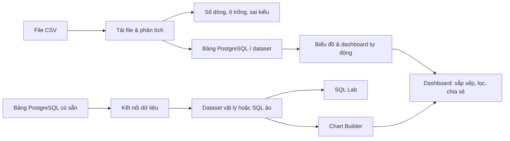

# Pythera Data Studio — BI Dashboard POC

Phiên bản thử nghiệm để chứng minh một luồng BI cơ bản: **đưa dữ liệu vào → kiểm tra và truy vấn → tạo biểu đồ → trình bày trên dashboard**. Đây là ứng dụng chạy trên máy của người thử nghiệm, không phải website đã triển khai trên Internet hay sản phẩm sẵn sàng dùng với dữ liệu thật.

Mã nguồn gồm Spring Boot (API), React/TypeScript (giao diện), ECharts (biểu đồ) và PostgreSQL (dữ liệu). [Slide báo cáo POC](demo/Bao_cao_PoC_BI_Dashboard.pptx) và [CSV để thử](demo/doanh_thu_poc.csv) có sẵn trong repo.

## Hai luồng có thể thử



- **CSV:** nhập file UTF-8; hệ thống suy kiểu, báo ô trống/sai kiểu, lưu thành bảng trong schema `uploads`, rồi tạo dataset, biểu đồ và dashboard.
- **PostgreSQL:** kết nối database có bảng sẵn; chọn bảng vật lý hoặc viết một câu `SELECT` làm dataset ảo; chạy SQL, tự cấu hình biểu đồ và thêm vào dashboard.

## Chạy từ bản clone trên Windows

**Cần cài trước:** Git, JDK 17, Maven, PostgreSQL 18 và Node.js `^20.19.0` hoặc `>=22.12.0`. Các lệnh `git`, `java`, `mvn` và `npm` phải dùng được trong CMD/PowerShell. Cần có mạng ở lần đầu để Maven và npm tải thư viện. Cổng **8081** (web) và **5433** (PostgreSQL riêng của POC) phải còn trống. Quy trình này đã được kiểm tra trên Windows với Java 17, Maven 3.9, Node 22 và PostgreSQL 18.

Mở PowerShell hoặc CMD:

```powershell
git clone https://github.com/gnohp0309/bi-poc.git
cd bi-poc
powershell -NoProfile -ExecutionPolicy Bypass -File .\dev\start-demo.ps1
```

**Lần chạy đầu**, script tự chạy `npm ci`, build giao diện, đóng gói Spring Boot, tạo PostgreSQL cục bộ trong `.local/pgdata`, rồi mở ứng dụng ở [http://127.0.0.1:8081/](http://127.0.0.1:8081/). Chạy lại sẽ dùng dữ liệu đã có; không tự xóa hoặc nạp dữ liệu mẫu. Repo không chứa `node_modules`, file JAR hay database của máy tác giả.

Nếu PostgreSQL không nằm trong `PATH` hoặc `C:\Program Files\PostgreSQL\<phiên bản>\bin`, đặt `POC_POSTGRES_BIN` trước khi chạy, ví dụ:

```powershell
$env:POC_POSTGRES_BIN = 'D:\Tools\PostgreSQL\18\bin'
powershell -NoProfile -ExecutionPolicy Bypass -File .\dev\start-demo.ps1
```

| Tài khoản thử | Mật khẩu | Quyền |
| --- | --- | --- |
| `admin` | `Demo2026!` | Quản trị, nhật ký |
| `analyst` | `Demo2026!` | Tạo/sửa nội dung |
| `viewer` | `Demo2026!` | Chỉ xem |

Các mật khẩu trên là **mật khẩu mẫu công khai**. Ứng dụng mặc định chỉ nghe trên `127.0.0.1`; chỉ dùng dữ liệu giả lập và không mở cổng ra mạng khi chưa thay cấu hình bảo mật.

## Thử luồng CSV trong 3–5 phút

1. Đăng nhập `admin`, vào **Tải file & phân tích**, chọn `demo/doanh_thu_poc.csv`, đặt tên “Doanh thu bán hàng mẫu 2025”, bấm **Nhập file và tạo dashboard**.
2. Đối chiếu kết quả: **12 dòng**, **2 ô trống**, **2 ô sai kiểu**, tổng `doanh_thu` **9.700.000**. Ô sai kiểu thành `NULL` nhưng dòng vẫn được giữ.
3. Bấm **Mở dashboard**. Chọn chiều lọc `c_khu_vuc`, nhập `Miền Bắc`, bấm **Áp dụng**; biểu đồ theo khu vực cho **3.600.000**.
4. Vào **Kết nối dữ liệu** → **Xem bảng** và **Datasets** → **Xem trước** để thấy file đã trở thành bảng `uploads.csv_...` trong PostgreSQL. Tên bảng có mã mới sau mỗi lần tải; không dùng tên bảng cũ trong SQL đã lưu.
5. Vào **Chart Builder**, chọn dataset CSV, biểu đồ **Cột**, chiều `c_khu_vuc`, phép **Tổng**, chỉ số `c_doanh_thu`. Xem trước rồi lưu và thêm vào dashboard.

Muốn thử lại từ bước tải file, dùng **Xóa lần nhập** trên trang nhập file. Thao tác này xóa bảng, dataset và dashboard tạo từ lần nhập ấy. Kết nối CSV vẫn có thể còn trong danh sách.

## Thử luồng PostgreSQL có sẵn

Sau khi web chạy, mở terminal khác trong thư mục repo và nạp dữ liệu mẫu:

```powershell
powershell -NoProfile -ExecutionPolicy Bypass -File .\dev\seed-demo.ps1
```

Script tạo `bi_poc_source.public.orders` (24 dòng), `public.products` (7 dòng), kết nối **PostgreSQL · Bán hàng mẫu**, dataset, ba biểu đồ và dashboard “Tổng quan bán hàng 2025”. Trong **SQL Lab**, chọn đúng kết nối này rồi chạy:

```sql
SELECT to_char(order_date, 'YYYY-MM') AS thang,
       SUM(amount) AS doanh_thu
FROM public.orders
GROUP BY to_char(order_date, 'YYYY-MM')
ORDER BY thang
```

Để tạo **dataset ảo**, vào **Datasets** → kết nối **PostgreSQL · Bán hàng mẫu** → **SQL ảo**, dán câu `SELECT` trên, lưu và xem trước. Trong Chart Builder, chọn dataset mới; chiều `thang`, phép **Tổng**, chỉ số `doanh_thu`, biểu đồ **Đường**.

**Phân biệt hai database:** `bi_poc_app` lưu cấu hình và bảng CSV trong schema `uploads`; `bi_poc_source` chứa `public.orders` và `public.products`. Câu `FROM public.orders` sẽ lỗi nếu chọn kết nối **CSV imports (read-only)**. Link dashboard chứa `127.0.0.1` chỉ mở được trên máy đang chạy POC.

## Các màn hình và giới hạn POC

| Màn hình | Có thể thử | Giới hạn cần biết |
| --- | --- | --- |
| Tổng quan | Xem số nguồn, dataset, biểu đồ, dashboard | Số liệu mô tả trạng thái cục bộ |
| Tải file & phân tích | CSV UTF-8; chất lượng dữ liệu; dashboard tự động | Chỉ CSV dấu phẩy, tối đa 200 MB/32 cột/1 triệu dòng; ngày `YYYY-MM-DD`; giá trị sai kiểu thành `NULL` |
| Kết nối dữ liệu | Kiểm tra, lưu, duyệt bảng PostgreSQL | Chưa có MySQL/SQLite; host được giới hạn cho bản demo |
| Datasets | Bảng vật lý, một câu SQL ảo, xem trước, nhãn cột | Nhãn chưa tự đổi tên trên biểu đồ; chưa có kho metric |
| SQL Lab | Chạy/lưu `SELECT` hoặc `WITH` chỉ đọc | Tối đa 500 dòng/6 giây; truy vấn lưu phụ thuộc bảng nguồn còn tồn tại |
| Chart Builder | Cột, đường, tròn; chiều dữ liệu; SUM/COUNT/AVG | Chưa có công thức và bộ lọc nhiều điều kiện |
| Dashboards | Thêm biểu đồ, đổi thứ tự, lọc một chiều, link/iframe | Chưa kéo thả tự do theo lưới; bộ lọc chỉ tác động biểu đồ cùng chiều |
| Bảo mật & nhật ký | Admin/Analyst/Viewer, nhóm, nhật ký thao tác | Chưa phân quyền riêng từng dashboard/chart/dataset, chưa có SSO |

Đây là **bằng chứng khả thi**, không phải bản Metabase hoàn chỉnh. Link chia sẻ dashboard là công khai với ai có token và mở được máy chủ; không dùng với dữ liệu nhạy cảm.

## Build, kiểm tra, dừng và làm lại

- Build lại sau khi sửa mã: `powershell -NoProfile -ExecutionPolicy Bypass -File .\dev\build-demo.ps1`. Dừng app trước khi build lại JAR trên Windows bằng `dev\stop-demo.ps1`.
- Kiểm tra luồng CSV (tạo rồi dọn dữ liệu test): `powershell -NoProfile -ExecutionPolicy Bypass -File .\dev\smoke-import.ps1`.
- Kiểm tra thêm các phân hệ PostgreSQL sau khi chạy `seed-demo.ps1`: `powershell -NoProfile -ExecutionPolicy Bypass -File .\dev\smoke.ps1`.
- Dừng ứng dụng: `powershell -NoProfile -ExecutionPolicy Bypass -File .\dev\stop-demo.ps1`. Nếu muốn dừng cả PostgreSQL cục bộ, chạy tiếp `powershell -NoProfile -ExecutionPolicy Bypass -File .\dev\stop-postgres.ps1`. Dữ liệu vẫn nằm trong `.local/pgdata`.
- Đặt lại toàn bộ bản demo: `powershell -NoProfile -ExecutionPolicy Bypass -File .\dev\reset-demo.ps1`. Script sao lưu database vào `.local/backups`, rồi **xóa cả bảng CSV, `orders`/`products`, kết nối, dataset, biểu đồ và dashboard**. Chỉ dùng khi thật sự muốn trở về trạng thái trống.

Mã nguồn và file CSV mẫu vẫn nguyên sau khi đặt lại. `.local` chứa database/log/backup riêng của từng máy và không được đưa lên Git. Nếu ứng dụng không khởi động, xem `.local/app.err.log`; nếu thiếu công cụ, kiểm tra các lệnh trong phần yêu cầu cài đặt; nếu cổng 5433 bị chiếm, dừng tiến trình đang dùng cổng đó trước khi chạy POC.
